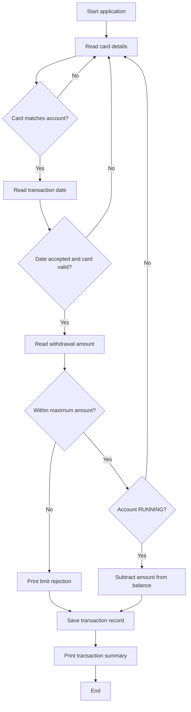

# ATM Transaction Simulator in C

A modular, console-based **ATM transaction simulation** implemented in **C99**. The application collects card details, checks a small in-memory account database, performs several transaction checks, and stores a transaction summary.

The project separates responsibilities into **Card**, **Terminal**, and **Server** modules and uses **CMake** for project configuration.

> **Educational project:** This is a basic transaction-processing exercise, not a secure or production-ready ATM. Account records are hardcoded, several validation paths are incomplete, and sensitive data handling is not appropriate for real banking software.

## 1. Overview

The application demonstrates a simplified withdrawal workflow:

1. Prompt for cardholder name, card expiration date, and primary account number (PAN).
2. Search the account database for matching card information.
3. Read a transaction date and check the card expiration.
4. Read a requested amount and compare it with the terminal transaction limit.
5. Check whether the account is active (`RUNNING`) or blocked (`BLOCKED`).
6. On the accepted path, subtract the requested amount from the in-memory account balance.
7. Store and print a transaction record.

The `main.c` loop is configured to stop after **one transaction reaches the recording step**. Some rejected paths restart the input process instead of recording a rejection.

## 2. Technologies and concepts

| Technology / concept | Role |
|---|---|
| C99 | Application language |
| CMake | Build configuration |
| Command-line I/O | Interaction using `printf` and `scanf` |
| Structures and enums | Card, terminal, account, and transaction models |
| Arrays | In-memory accounts and transaction records |
| Functions and modules | Card / terminal / server separation |
| CLion | IDE-related build files included in the repository |

## 3. Repository structure

```text
ATM-C-project/
├── CMakeLists.txt
├── defines.h                    # Shared data structures, types, and constants
├── main.c                       # Application workflow and sample accounts
├── card/
│   ├── card.c                   # Card input and database matching
│   └── card.h
├── terminal/
│   ├── terminal.c               # Date, amount, and transaction-limit checks
│   └── terminal.h
├── server/
│   ├── server.c                 # Account-state check and transaction record
│   └── server.h
└── cmake-build-debug/           # IDE-generated build artifacts (not source)
```

The repository contains `cmake-build-debug/` files from a prior local build. These are generated outputs and may not be portable across systems.

## 4. Software architecture

The implementation separates card data collection, terminal operations, and account/transaction operations:



This diagram reflects the control flow of the committed `main.c`, including the fact that the **over-limit branch** can still reach the transaction-saving step with a non-accepted status. It is not a complete banking-authorization state machine.

### 4.1 Card module

Files: [`card/card.c`](card/card.c), [`card/card.h`](card/card.h)

| Function | Purpose |
|---|---|
| `getCardHolderName()` | Reads a cardholder name; checks its length is 20–24 characters |
| `getCardExpiryDate()` | Reads a five-character expiration-date string |
| `getCardPAN()` | Reads a 19-character PAN string |
| `Card_Confirm()` | Searches stored accounts for a matching PAN, name, and expiration string |

The card comparison is performed using nested character comparisons rather than a database library or cryptographic verification.

### 4.2 Terminal module

Files: [`terminal/terminal.c`](terminal/terminal.c), [`terminal/terminal.h`](terminal/terminal.h)

| Function | Purpose |
|---|---|
| `getTransactionDate()` | Reads a five-character transaction-date string |
| `isCardExpired()` | Compares transaction and card-expiration dates |
| `getTransactionAmount()` | Reads an amount and checks that it is positive |
| `setMaxAmount()` | Configures the maximum permitted transaction amount |
| `isBelowMaxAmount()` | Checks whether the requested amount exceeds the configured maximum |

In the current code, the date comparison uses arithmetic on the **character codes**, not a parsed date structure. It also does not validate that the date contains a legitimate month/year.

### 4.3 Server module

Files: [`server/server.c`](server/server.c), [`server/server.h`](server/server.h)

| Function | Purpose |
|---|---|
| `check_the_state()` | Accepts accounts in the `RUNNING` state; rejects `BLOCKED` |
| `save_trans()` | Copies selected card and terminal fields into a transaction record |

Balance subtraction occurs in `main.c` after the account-state check, not inside `server.c`.

## 5. Data structures

The project defines its shared types and constants in [`defines.h`](defines.h).

### Card data

```c
typedef struct ST_cardData_t {
    uint8_t cardHolderName[25];
    uint8_t primaryAccountNumber[20];
    uint8_t cardExpirationDate[6];
} ST_cardData_t;
```

### Terminal data

```c
typedef struct ST_terminalData_t {
    float transAmount;
    float maxTransAmount;
    uint8_t transactionDate[6];
} ST_terminalData_t;
```

### Account status and account record

```c
typedef enum state {
    RUNNING,
    BLOCKED
} state_t;

typedef struct data_base {
    uint8_t cardHolderName[25];
    uint8_t primaryAccountNumber[20];
    uint8_t cardExpirationDate[6];
    float balance;
    state_t state;
} data_base;
```

### Saved transaction

```c
typedef struct ST_transaction {
    uint8_t name[22];
    uint8_t PAN[20];
    uint8_t trans_date[6];
    uint8_t trans_status[10];
    float new_balance;
} ST_transaction_t;
```

**Implementation note:** `uint8_t` is defined locally as `typedef char uint8_t;`. It is therefore **not guaranteed to behave like the standard unsigned 8-bit `uint8_t`** and its signedness can affect sentinel values such as `-1`.

## 6. Sample database and configuration

`main.c` contains a global account array with capacity for **10** entries (`n = 10`), but only **two** entries are explicitly initialized:

| Sample record | Initial balance | Status |
|---|---:|---|
| First account | 2,000 | `RUNNING` |
| Second account | 3,000 | `BLOCKED` |

Their test card fields are hardcoded in `main.c`; refer to that file for the local demonstration inputs. Avoid using genuine card details.

The transaction-limit macro is:

```c
#define MaxAmount 1000000
```

At startup, the application passes this value into `setMaxAmount(&T_DATA, MaxAmount)`.

> **No persistent storage:** Balances and transaction history exist only in the program's memory. Changes are lost when the process ends.

## 7. How a transaction is handled

### Card confirmation

The program collects the name, expiration date, and PAN and compares them with the account array. A matching record supplies the account index used by later checks.

### Transaction validation

After a match, the program requests the transaction date, an amount, and checks the maximum amount. It then checks the account status.

The accepted withdrawal path performs:

```c
accounts[x].balance -= T_DATA.transAmount;
state = 1;
```

The code **does not** currently verify whether the requested amount is less than or equal to the available balance. It can therefore produce a negative balance.

### Recording and output

The application calls `save_trans(...)` for paths reaching the recording step and prints a summary containing the cardholder name, PAN, transaction status, date, and new balance.

In `main.c`, the loop stops once `count` reaches `1`. This is a **single-record demonstration** under the current control flow, rather than an interactive multi-transaction ATM session.

## 8. Building and running

### Prerequisites

- A C99-compatible compiler (for example, GCC or Clang).
- CMake **3.22 or later**, as specified in `CMakeLists.txt`.
- A terminal or C/C++ IDE with CMake support.

### Clone the repository

```bash
git clone https://github.com/ahmednabildo/ATM-C-project.git
cd ATM-C-project
```

### Configure and build

The supplied CMake project defines an executable named `seif_FWD`:

```cmake
cmake_minimum_required(VERSION 3.22)
project(seif_FWD C)
set(CMAKE_C_STANDARD 99)
```

Typical out-of-source build commands are:

```bash
cmake -S . -B build
cmake --build build
```

**Source-build caveat:** Some headers use root-relative include strings (for example, `server/server.h` includes `terminal/terminal.h`), but the current `CMakeLists.txt` does not explicitly add the project root as an include directory. A clean build may therefore require an include-directory adjustment, such as:

```cmake
target_include_directories(seif_FWD PRIVATE ${CMAKE_CURRENT_SOURCE_DIR})
```

This is a suggested configuration change, **not** a change already made to the repository. The code also has portability and input-safety issues described below; successful compilation alone does not establish correct behavior.

### Run the application

On Linux or macOS after a successful build:

```bash
./build/seif_FWD
```

On Windows, with a generator placing the executable directly in the build folder:

```powershell
.\build\seif_FWD.exe
```

Some multi-configuration Windows generators instead place it under `build/Debug/`.

### Example interaction

The prompts in the current code include:

```text
Enter your name:
Enter the card expiry date:
Enter the PAN:
Enter the trans date:
Enter the transaction amount:
```

For a locally configured account, the accepted path prints `found` and `trans accepted`, followed by a stored transaction summary. The exact output depends on the input and account status.

Do not enter real card numbers or personally sensitive information; the demonstration prints PAN values in plain text.

## 9. Current limitations

The following are characteristics of the actual committed implementation, not proposed features:

1. **Hardcoded account records:** There is no real database, authentication service, or persistence.
2. **Input-size safety:** Several `scanf("%s", ...)` calls have no field-width limit and can overflow local buffers.
3. **Inconsistent validation:** `main.c` does not check every input function's return value. For example, a rejected amount can leave an invalid value in the flow.
4. **Date checking:** Expiration logic operates on character values rather than parsed dates; input is checked mainly by string length.
5. **Card lookup sentinel:** `Card_Confirm()` returns `-1` through a `uint8_t` alias of `char`, which depends on implementation-defined `char` signedness.
6. **Funds verification:** No insufficient-balance check is performed before withdrawal.
7. **Transaction logs:** Some failures loop back without being logged; other failures may reach the recording step.
8. **String termination:** `save_trans()` copies fields without consistently appending null terminators, which can make `%s` printing unsafe.
9. **Money representation:** Monetary values use `float`, which is unsuitable for exact financial accounting.
10. **Single transaction:** The main loop is configured to record one transaction per execution.
11. **Privacy:** The application stores and displays full PAN strings; it must not be used with real payment credentials.
12. **Testing:** The repository does not contain an automated test suite.

## 10. Possible improvements

- Replace unbounded string reads with width-limited input or `fgets`, followed by robust parsing.
- Use standard fixed-width integer types from `<stdint.h>` and explicit error-status types.
- Add header guards and make include paths portable in CMake.
- Parse and validate month/year values, including invalid-date cases.
- Check account balance before approving a withdrawal.
- Represent money as integer minor units (for example, cents).
- Separate transaction authorization, balance mutation, and record creation.
- Record **all** accepted and rejected transactions with well-defined status codes.
- Add a menu supporting multiple transactions, deposits, and balance inquiries.
- Use test-only masked account identifiers and avoid printing full PANs.
- Add unit tests for valid, blocked, expired, over-limit, and insufficient-funds cases.
- Store demonstration accounts and transaction results in a local file or lightweight database.

## 11. Project context

This project demonstrates introductory C software engineering concepts: modular program structure, arrays, structures, enumerations, function calls, console input, conditional control flow, and a basic transaction-processing workflow.

The repository is intended for **learning and demonstration**, not deployment in financial systems.

## Author

**Ahmed Nabil Donia**  
[GitHub profile](https://github.com/ahmednabildo)
